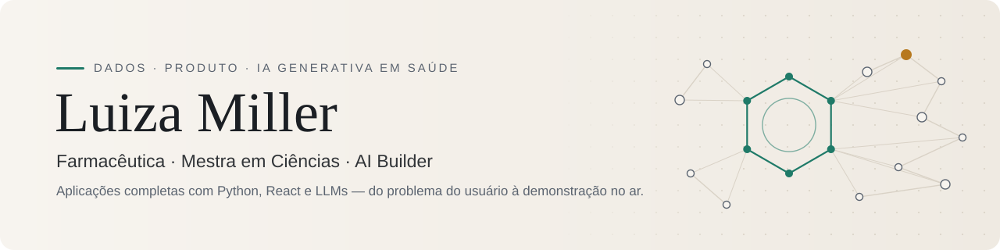
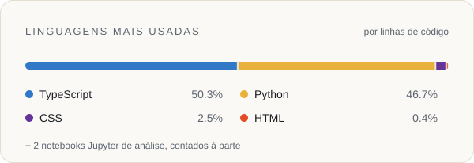
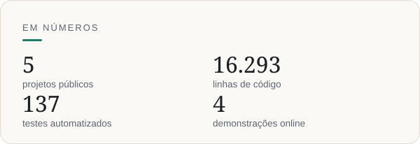

<picture>
  <source media="(prefers-color-scheme: dark)" srcset="assets/banner-escuro.svg">
  
</picture>

 

&nbsp;&nbsp;
&nbsp;&nbsp;

 

Sou farmacêutica e mestra em Bioquímica e Bioprospecção (UFPel), com experiência em farmácia hospitalar, pesquisa em IA aplicada à saúde e gestão de produto como Product Owner. Construo aplicações completas que unem **dados, produto e IA generativa**: do problema do usuário às regras de negócio, ao código testado e à demonstração no ar.

## Projetos

Todos com código aberto, testes automatizados e **demonstração que abre direto no navegador**: o backend Python de cada projeto roda dentro da própria página (Pyodide), sem instalar nada.

<table>
<tr>
<td width="50%" valign="top">

<h3><a href="https://github.com/Luizamiller/umami">UMAMI</a></h3>
App de delivery com sacola de <b>até quatro lojas</b> e entrega combinada. Login em etapas com código, opções de produto, cupons e acompanhamento por loja. Um assistente monta a sacola a partir de um pedido em linguagem natural, sempre conferido por regras determinísticas (24 de 24 casos de avaliação).
  
FastAPI · SQLAlchemy · Claude API · React · TypeScript · Tailwind · Motion
  
<a href="https://luizamiller.github.io/umami/"><b>Abrir demonstração</b></a> · <a href="https://github.com/Luizamiller/umami">Código</a>
</td>
<td width="50%" valign="top">

<h3><a href="https://github.com/Luizamiller/sabias-reflexoes-ia">Às Sábias Reflexões</a></h3>
Acervo de podcast com IA: recebe o vídeo, transcreve com Whisper, gera 8 peças de conteúdo com o Claude e validação contra alucinação, e só publica após revisão humana. Um assistente responde citando episódio e minuto, com busca híbrida que acerta 89% do gabarito original.
  
FastAPI · scikit-learn · Claude API · Whisper · n8n · React · TypeScript
  
<a href="https://luizamiller.github.io/sabias-reflexoes-ia/"><b>Abrir demonstração</b></a> · <a href="https://github.com/Luizamiller/sabias-reflexoes-ia">Código</a>
</td>
</tr>
<tr>
<td width="50%" valign="top">

<h3><a href="https://github.com/Luizamiller/fale-com-farmaceutico">Fale com o Farmacêutico</a></h3>
Atendimento farmacêutico dentro do delivery, com três perfis: cliente, farmacêutico e encarregado de dados. Triagem em 5 etapas, fila priorizada por risco, checagem de interações e rascunhos de IA que só saem com aprovação do farmacêutico. LGPD e trilha de auditoria verificável.
  
FastAPI · SQLAlchemy · Claude API · React · TypeScript · LGPD
  
<a href="https://luizamiller.github.io/fale-com-farmaceutico/"><b>Abrir demonstração</b></a> · <a href="https://github.com/Luizamiller/fale-com-farmaceutico">Código</a>
</td>
<td width="50%" valign="top">

<h3><a href="https://github.com/Luizamiller/analise-restaurantes-ifood">Panorama Delivery</a></h3>
Análise de 406 mil restaurantes do iFood (dados públicos). 44% aparecem com nota 0 por não exibirem nota: tratar o zero como nota derrubaria a média de 4,51 para 2,52. Os achados viraram uma plataforma com narrativa, mapa por estado e ranking de categorias.
  
Python · pandas · DuckDB · FastAPI · React · TypeScript
  
<a href="https://luizamiller.github.io/analise-restaurantes-ifood/"><b>Abrir demonstração</b></a> · <a href="https://github.com/Luizamiller/analise-restaurantes-ifood">Código</a>
</td>
</tr>
</table>

**Também:** [Análise de comentários de restaurantes](https://github.com/Luizamiller/analise-comentarios-restaurantes) — acima de 60 min de entrega, as avaliações negativas sobem de cerca de 5% para 35% (base sintética, com limpeza documentada).

---

## Em números

<table>
<tr>
<td width="50%" valign="top">

<picture>
  <source media="(prefers-color-scheme: dark)" srcset="assets/linguagens-escuro.svg">
  
</picture>

</td>
<td width="50%" valign="top">

<picture>
  <source media="(prefers-color-scheme: dark)" srcset="assets/numeros-escuro.svg">
  
</picture>

</td>
</tr>
</table>

Calculado a partir do código dos repositórios públicos por um GitHub Action que roda todo dia (<a href="scripts/estatisticas.py">script</a>). Notebooks Jupyter ficam fora da porcentagem, porque as saídas salvas inflariam a conta.

---

## Tecnologias

Clique em um ícone para abrir o site da tecnologia.

<b>IA generativa e automação</b> 
&nbsp;
&nbsp;

<b>Desenvolvimento</b> 
&nbsp;
&nbsp;
&nbsp;
&nbsp;
&nbsp;
&nbsp;
&nbsp;
&nbsp;
&nbsp;
&nbsp;
&nbsp;
&nbsp;

<b>Dados</b> 
&nbsp;
&nbsp;
&nbsp;
&nbsp;

<b>Produto e ferramentas</b> 
&nbsp;
&nbsp;
&nbsp;

**Também:** engenharia de prompt, saída estruturada (JSON), RAG com citação verificada, agentes com validação determinística, avaliação de respostas e humano no circuito · ChatGPT, Gemini, Whisper, Make, Zapier · Playwright, Alembic · bioinformática (PyDESeq2, lifelines, WGCNA) · Scrum, Kanban, métricas e KPIs, design de interface · LGPD e privacidade desde o desenho

---

## Formação e experiência

- **Product Owner** — Podcast Às Sábias Reflexões (dez/2024 – ago/2025)
- **Farmacêutica** — Hospital Universitário São Francisco de Paula, Pelotas/RS (dez/2024 – nov/2025)
- **Pesquisadora** — Grupo de IA e Análise Preditiva em Saúde (GIAAPS), UFPel (2022 – 2023)
- Tecnólogo em Análise e Desenvolvimento de Sistemas — UniFatecie (previsão: jul/2027)
- Mestrado em Ciências, Bioquímica e Bioprospecção — UFPel (2024)
- Bacharelado em Farmácia — UFPel (2022)
